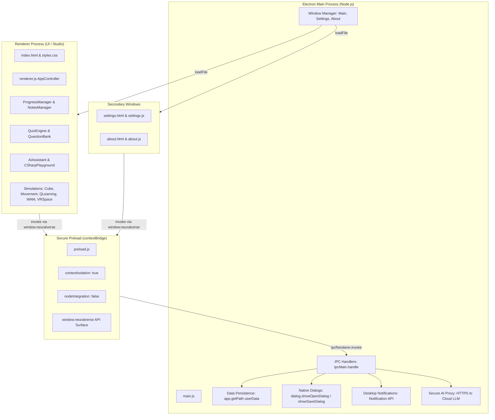

# NeuralVerse — Interactive VR & AI Learning Studio

[](https://www.electronjs.org/)
[](https://nodejs.org/)
[](LICENSE)
[]()

> **Interactive Desktop Learning Studio** designed for the NPTEL/SWAYAM course **Mobile Virtual Reality and Artificial Intelligence**. Features structured course modules, interactive 3D and AI laboratories, a built-in AI Learning Assistant (offline & cloud LLM), live C# code playground, Q-learning agent simulator with parameter tuning, 360° VR laboratory, gamified progress tracking, and native Electron desktop features.

---

## 1. Project Overview & Architecture

### Objectives
NeuralVerse bridges high-level academic theory with hands-on technical practice:
1. **Curriculum Coverage:** 25 structured lessons across 4 core NPTEL modules (VR fundamentals, Unity GameObjects, C# scripting, Deep RL / Q-learning, Google Cardboard, and Imitation Learning).
2. **Interactive Demonstrations:** Five fully functional interactive labs that run directly on desktop without external dependencies.
3. **AI Learning Tutor:** Context-aware tutoring with ELI5 explanations, guided hints before solutions, practice challenges, and offline fallback.
4. **Desktop Native Architecture:** Strict Electron security (`contextIsolation: true`, `nodeIntegration: false`), secure IPC preload bridge, native OS file dialogs, desktop notifications, and persistent JSON storage.

---

## 2. Feature Highlights

### 🎨 Modern Futuristic UI/UX
- **Dark Neon & Solar Light Modes** with 5 customizable accent themes (Cyan, Emerald, Violet, Amber, Rose).
- **Collapsible sidebar**, glowing glassmorphic cards, responsive layouts, and smooth animations.
- **Global search modal (`Ctrl+K` / `Cmd+K`)** to instantly find lessons, terms, and labs.
- **Quick-access AI Assistant drawer (`Alt+A`)** from any view.

### 📊 Smart Learning Dashboard & Gamification
- **Real-time KPI metrics:** Total lessons completed, study streak, quiz scores, total XP, and student rank level.
- **Weekly study activity bar chart** mapping time spent from Monday through Sunday.
- **Daily learning goal progress bar** tracking active session study time.
- **Unlockable milestone badges:** *First Step*, *Knowledge Scholar*, *Quiz Master*, *Streak Flame*, and *Scribe*.

### 🧪 Interactive Learning Laboratories
1. **3D Transform & Lighting Lab:** Interactive cube with Euler rotation, scaling, wireframe modes, dynamic directional lighting, and instant camera reset.
2. **C# Code Playground:** In-browser C# code editor with runnable Unity scripts (Player movement, Bellman equation, Gaze reticle dwell timers, explosion physics) and simulated console/debug output.
3. **Q-Learning Laboratory:** Tabular grid-world agent with real-time parameter controls ($\alpha$ learning rate, $\gamma$ discount, $\epsilon$ exploration), Q-value heatmap, and live rewards chart.
4. **360° VR Space Demo:** First-person virtual laboratory with WASD navigation, mouse drag view angle, interactive research stations, and depth projection.
5. **Whack-a-Mole Minigame:** Playable reaction game with 3 difficulty modes (Easy, Normal, Hard), score and streak counters, bomb traps, audio synthesis, and restart options.

### 🤖 Intelligent AI Learning Assistant
- **Built-in Offline Knowledge Engine:** Instant explanations, concept analogies, viva hints, and practice problems without requiring an API key or internet connection.
- **Optional Cloud AI Support:** Main-process HTTPS connector for OpenAI, Anthropic Claude, or local Ollama endpoints without exposing API keys to the frontend renderer.

### 📝 Notes, Revision & Assessments
- **Full Notes CRUD:** Create, edit, search, tag, pin, and delete study notes.
- **Native File Dialogs:** Import and export notes as JSON or formatted Markdown (`.md`).
- **Comprehensive Assessment Engine:** Module quizzes and course final exam featuring multiple choice, true/false, and code-based questions.
- **Mistakes Revision Deck:** Automatic logging of incorrect quiz answers with one-click review mode and detailed explanations.

---

## 3. Course-to-Feature Curriculum Mapping

| Module | Core Topics | In-App Labs & Practical Exercises |
| :--- | :--- | :--- |
| **Module 1: Virtual Reality & Unity 3D** | VR History, 3DOF vs 6DOF, Presence, Latency, Unity Editor, GameObjects, Primitives, Transform, Materials, Shaders, Lighting, Colliders | • **3D Transform Lab** with Euler rotation, scaling, wireframe, and lighting controls.<br>• **360° VR Lab** concept walkthrough. |
| **Module 2: C# Programming & Interaction** | C# syntax, methods, loops, lifecycle (`Start`, `Update`, `FixedUpdate`), `Input.GetAxis`, `Time.deltaTime`, cameras, prefabs, explosions | • **C# Code Playground** with live compilation simulation.<br>• Production Unity C# scripts for movement, camera following, and radial physics. |
| **Module 3: Deep Reinforcement Learning** | MDPs, States, Actions, Rewards, Tabular Q-Learning, Bellman Equation, $\epsilon$-greedy exploration, Taxi benchmark, Unity ML-Agents PPO | • **Q-Learning Simulator** with real-time parameter tuning ($\alpha, \gamma, \epsilon$), live reward chart, and Q-table heatmaps.<br>• `RollerAgent.cs` for Unity ML-Agents. |
| **Module 4: Mobile Virtual Reality** | Mobile VR constraints, Google Cardboard SDK, Gaze reticles, Dwell timers, Whack-a-Mole minigame, Blender pipeline, Imitation Learning | • **Whack-a-Mole Minigame** with difficulty modes.<br>• **3DOF Gaze Reticle Simulation** with raycasting dwell timers. |

---

## 4. Electron Architecture & Security Design



### Security Checklist:
- ✅ `contextIsolation: true` is strictly enforced across all windows.
- ✅ `nodeIntegration: false` prevents renderer execution of Node.js modules.
- ✅ Preload bridge exposes only explicit, sanitized methods (`window.neuralverse`).
- ✅ AI API keys are stored and dispatched strictly from the Main process; keys are never injected into the browser renderer.
- ✅ OS external links are validated for `http:`/`https:` protocols prior to invoking `shell.openExternal`.

---

## 5. Getting Started & Setup

### Prerequisites
- [Node.js](https://nodejs.org/) (Version 18.0.0 or higher)
- npm (Version 9.0.0 or higher)

### Setup & Run
```bash
# 1. Clone repository
git clone https://github.com/pandeysunny016-dot/NovaLearn-XR.git
cd NovaLearn-XR

# 2. Install dependencies
npm install

# 3. Run automated tests (7 tests covering data, logic, and offline AI)
npm test

# 4. Start the desktop application
npm start
```

### Keyboard Shortcuts
| Shortcut | Action |
| :--- | :--- |
| `Ctrl+K` / `Cmd+K` | Open Global Search |
| `Alt+A` | Toggle AI Learning Assistant |
| `Escape` | Close active modals & search drawers |

---

## 6. Real Implementations vs Educational Simulations

| Component | Implementation Details | Classification |
| :--- | :--- | :--- |
| **Electron Shell & IPC** | Multi-window orchestration, secure IPC preload bridge, native file dialogs, desktop notifications, JSON persistence. | **Production Implementation** |
| **Q-Learning Algorithm** | Tabular Bellman update equation: $Q(s, a) \leftarrow Q(s, a) + \alpha [R + \gamma \max Q(s', a') - Q(s, a)]$, dynamic $\epsilon$-decay, and live reward visualization. | **Full Tabular Algorithm** |
| **AI Learning Assistant** | Main-process secure HTTPS dispatcher for external LLMs with comprehensive offline fallback engine. | **Production Hybrid** |
| **Notes & Assessments** | Full CRUD notes engine, Markdown export, question bank with 5 pools, and mistakes revision tracker. | **Production Implementation** |
| **C# Code Playground** | Browser-based C# editor with simulated execution outputs for Unity MonoBehaviour scripts. | **Educational Simulation** |
| **360° VR Space Lab** | First-person 3D depth-projected canvas environment with WASD navigation and mouse-look. | **Concept Simulation** |
| **3D Transform & Lighting** | Matrix projection in HTML5 Canvas with Euler angles and directional shading. | **Concept Simulation** |
| **Unity C# Scripts** | Ready-to-use C# scripts in `unity-practicals/scripts/` for Unity Editor 2022+ LTS. | **C# Source Code** |

---

## 7. License
Licensed under the [MIT License](LICENSE).
