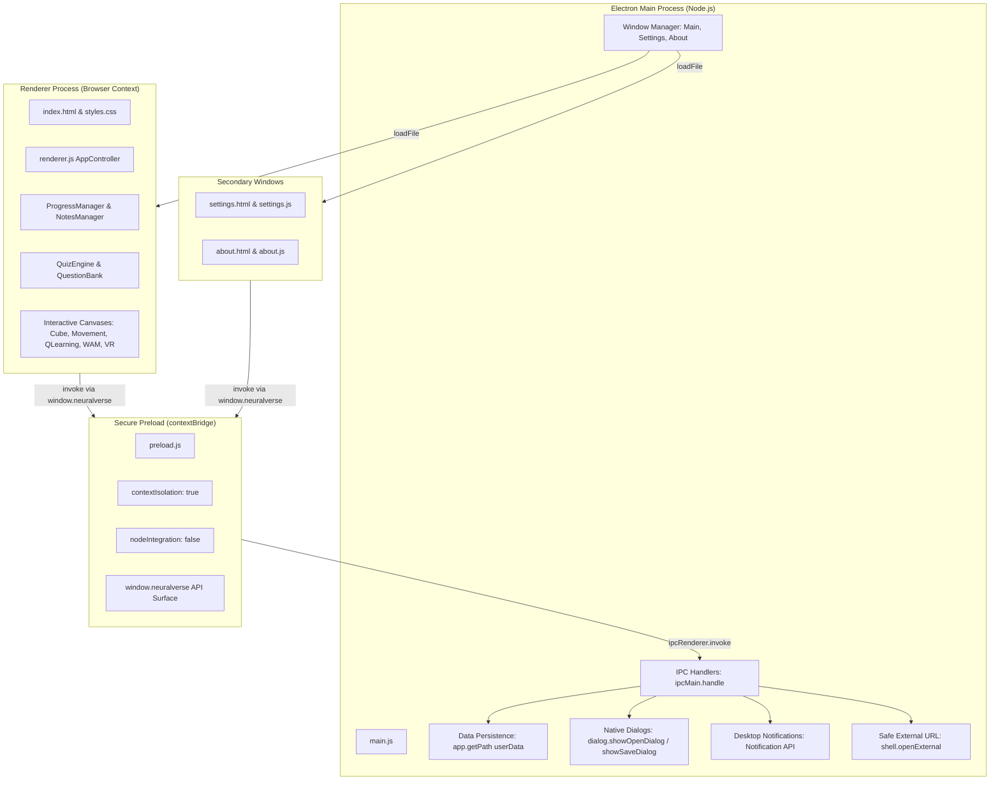

# NeuralVerse — Interactive VR & AI Learning Studio

[](https://www.electronjs.org/)
[](https://nodejs.org/)
[](LICENSE)
[]()

> **Desktop Educational Studio** designed for the NPTEL/SWAYAM course **Mobile Virtual Reality and Artificial Intelligence**. Integrates structured curriculum lessons, real-time Canvas 3D & RL simulations, full notes persistence, multiple native Electron windows, secure IPC preload architecture, and Unity practical engineering resources.

---

## 1. Project Overview & Problem Statement

### Problem Statement
Traditional online courses provide high-quality video lectures and reading materials, but students frequently struggle with:
1. Connecting theoretical concepts (such as 3DOF/6DOF tracking, Bellman equations, and PBR shaders) to practical implementations.
2. Experimenting with reinforcement learning without setting up heavy Python GPU environments.
3. Managing unified study notes, progress tracking, and assessments locally with persistent storage.
4. Bridging web-based conceptual models to production C# scripts in game engines like Unity 3D.

### Project Objective
**NeuralVerse** addresses this gap by providing an offline-first desktop laboratory with:
- Structured curriculum aligned with the NPTEL syllabus.
- Five hardware-accelerated interactive canvas simulations (3D Transform Gizmos, C# Physics Movement, Tabular Q-Learning, Whack-a-Mole VR, and 3DOF Gaze Reticles).
- Production C# scripts for Unity 3D and ML-Agents PPO.
- Real native desktop capabilities: separate BrowserWindow windows (Settings & About), native File Open/Save dialogs, desktop notifications, and persistent JSON storage.

---

## 2. Course-to-Feature Mapping Table

| NPTEL Course Module | Curriculum Concepts Covered | NeuralVerse Implementation & Lab Feature | Practical Status |
| :--- | :--- | :--- | :--- |
| **Module 1: Virtual Reality & Unity 3D** | VR History, HMDs, 6DOF, Presence, Unity Interface, GameObjects, Primitives, Transform, Materials, Shaders, Directional/Point Lights, Rigidbody & Colliders. | • 8 comprehensive lessons.<br>• **3D Transform & Lighting Lab**: Real-time canvas projection, Euler angle rotation, scale, wireframe toggles, and dynamic directional shading. | **Full In-App Canvas Simulation** + Unity Setup Guide |
| **Module 2: C# Programming & Interaction** | C# Syntax, Data Types, Access Modifiers, Methods, Lifecycle (Start/Update/FixedUpdate), Input, Time.deltaTime, Cameras, Menus, Prefabs, Explosions. | • 8 structured lessons with code snippets.<br>• **C# Player & Camera Physics Lab**: Top-down physics movement, obstacle collisions, collectible triggers, camera cycling (`Follow`, `Fixed`, `Orbit`), and radial explosion particle simulation. | **Interactive Simulation** + 5 Production C# scripts in `unity-practicals/scripts/` |
| **Module 3: Deep Reinforcement Learning** | Agent-Environment loop, States, Actions, Rewards, Tabular Q-Learning, Bellman Equation, Exploration vs Exploitation ($\epsilon$-greedy), Taxi benchmark, Unity ML-Agents & PPO. | • 5 detailed lessons.<br>• **Tabular Q-Learning Simulator**: Live agent grid world, dynamic obstacle penalty, goal rewards, real Bellman Q-table updates, $\epsilon$-decay, and directional Q-value heatmaps. | **Full Working Tabular RL Algorithm** + `RollerAgent.cs` for Unity ML-Agents PPO |
| **Module 4: Mobile Virtual Reality** | Mobile VR architecture, 3DOF tracking, Google Cardboard SDK, Gaze interaction, Dwell timers, Whack-a-Mole minigame, Blender 3D modeling pipeline, Imitation Learning. | • 6 comprehensive lessons.<br>• **Whack-a-Mole VR Minigame**: Timed reaction gameplay, mole pop-ups, bomb traps, particle effects, and scoring.<br>• **3DOF Gaze Reticle Lab**: Mouse-driven gyroscope simulation, raycast reticle targeting, and dwell-time activation. | **Playable Minigame & 3DOF Simulation** + Google Cardboard C# scripts |

---

## 3. Technology Stack & Electron Architecture

### Technology Stack
- **Framework:** Electron 28.0.0
- **Runtime:** Node.js (Main Process)
- **Renderer:** Vanilla JavaScript (ES6+), HTML5, and CSS3
- **Simulations:** Hardware-accelerated HTML5 Canvas 2D/3D matrix projection
- **Storage:** Local JSON persistence via `app.getPath('userData')`
- **Game Engine & Scripting:** Unity 3D (C#), Unity ML-Agents, Google Cardboard XR SDK

### Electron IPC & Security Architecture



### Security Best Practices Implemented:
1. `contextIsolation: true` is strictly enforced for all browser windows.
2. `nodeIntegration: false` ensures the renderer cannot directly execute arbitrary Node.js scripts.
3. No raw `ipcRenderer` or filesystem methods are exposed to the global `window` object.
4. Input validation and URL scheme checks (`http:` and `https:` whitelist) are executed inside IPC handlers before calling OS shell APIs.

---

## 4. Installation & Setup Instructions

### Prerequisites
- [Node.js](https://nodejs.org/) (Version 18.0.0 or higher)
- npm (Version 9.0.0 or higher)

### Installation Commands
```bash
# 1. Clone repository or navigate to project directory
cd NovaLearn-XR

# 2. Install dependencies
npm install

# 3. Run automated test suite
npm test

# 4. Launch the desktop application
npm start
```

---

## 5. College Viva Questions & Answers

**Q1: Why use `contextBridge` instead of enabling `nodeIntegration: true`?**  
*Answer:* Enabling `nodeIntegration` in the renderer creates severe security vulnerabilities: if remote content or untrusted scripts are loaded, they gain unrestricted access to the user's operating system, files, and shell. `contextBridge` creates an isolated, strictly-typed bridge that safely exposes only whitelisted functions.

**Q2: What is the difference between Tabular Q-Learning and Deep PPO?**  
*Answer:* Tabular Q-Learning stores discrete values in a lookup table for every state-action pair $Q(s, a)$. It works well for small state spaces (like our 5×5 grid), but fails in continuous or high-dimensional environments. Proximal Policy Optimization (PPO), used in Unity ML-Agents, employs deep neural networks to approximate policies in continuous observation and action spaces.

**Q3: How does Google Cardboard achieve 3D immersion with a smartphone?**  
*Answer:* Google Cardboard uses a biconvex dual-lens optical shell with a smartphone screen displaying side-by-side stereoscopic images (one per eye with inter-pupillary offset). Head tracking is achieved via the phone's internal 3DOF sensors (gyroscope and accelerometer), giving rotational orientation.

**Q4: Where does NeuralVerse persist user data across restarts?**  
*Answer:* The application uses `app.getPath('userData')`, which maps to the operating system's standard application data directory (`~/Library/Application Support/neuralverse` on macOS, `%APPDATA%\neuralverse` on Windows). This prevents data loss during reboots and keeps user state separate from temporary directories.

---

## 6. Real Implementations vs Educational Simulations

| Feature Component | Implementation Details | Classification |
| :--- | :--- | :--- |
| **Electron Desktop Shell** | Main process, multi-window orchestration, IPC handlers, native file dialogs, and persistent JSON I/O. | **Production Implementation** |
| **Q-Learning Algorithm** | Live Bellman update equation: $Q(s, a) \leftarrow Q(s, a) + \alpha [R + \gamma \max Q(s', a') - Q(s, a)]$, live $\epsilon$-decay, and directional heatmap rendering. | **Full Tabular Algorithm** |
| **Notes & Assessments** | Complete CRUD operations, tag filtering, search, native import/export, and question randomization with score tracking. | **Production Implementation** |
| **3D Transform & Lighting** | Matrix projection in HTML5 Canvas with Euler rotation, depth sorting, and Lambertian directional light calculations. | **Concept Simulation** |
| **Mobile VR Reticle & 3DOF** | Mouse drag-based gyroscope simulation with dwell-time gaze activation. | **Concept Simulation** |
| **Unity C# Project** | Production C# scripts for movement, cameras, explosions, and ML-Agents PPO. Requires Unity Editor LTS for full 3D build. | **C# Source Provided** |

---

## 7. Manual Testing Checklist

- [x] Application launches without JavaScript syntax errors.
- [x] Sidebar navigation smoothly switches between Dashboard, Course Library, Lessons, Labs, Assessments, Notes, and Unity Lab.
- [x] Course search bar instantly filters lessons and topics.
- [x] Lesson completion persists across application restarts.
- [x] Q-Learning simulator runs, updates Q-values visually, and resets properly.
- [x] Whack-a-Mole minigame tracks score, timers, and particle effects.
- [x] Assessments engine evaluates choices, displays explanations, and computes percentage scores.
- [x] Study Notes manager creates, edits, deletes, searches, and exports notes natively.
- [x] Settings window opens as a secondary window and prevents duplicate instances.
- [x] Desktop notifications display upon marking lessons complete.
